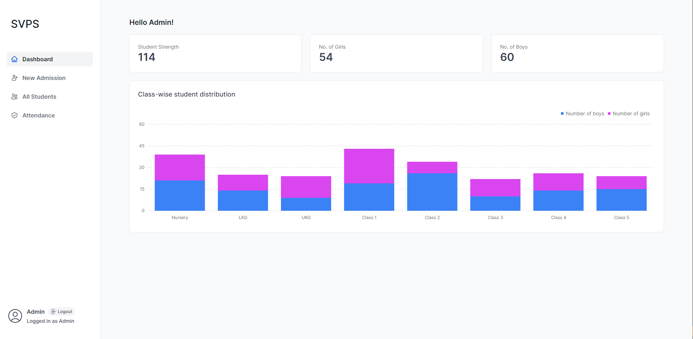
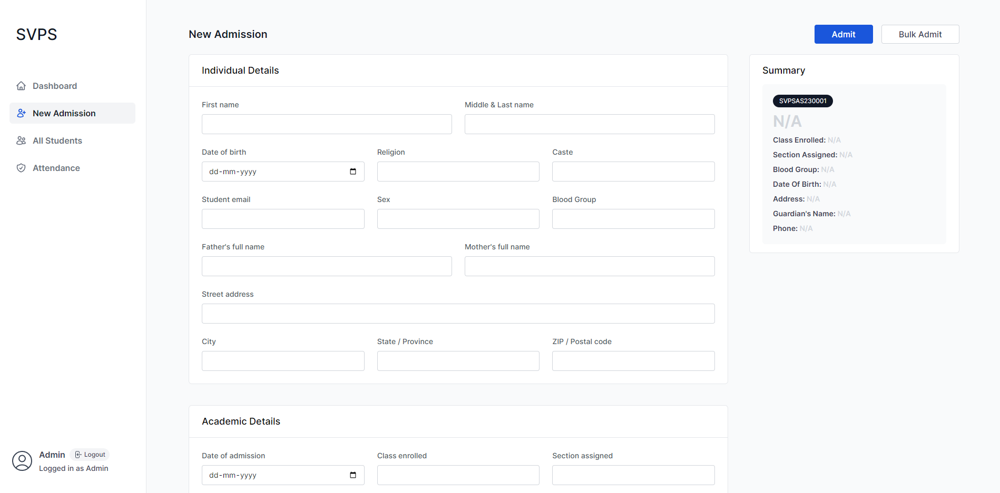
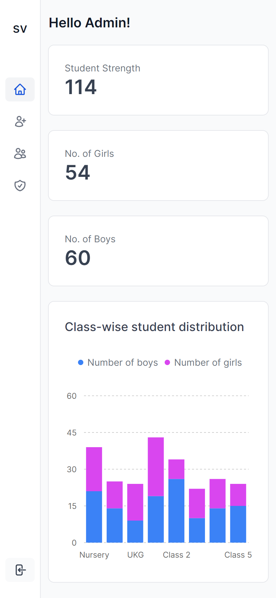

# schoolmanagementdashboardreacr
School Management Dashboard using React &amp; Tailwind CSS  

Guys just run below commands after got clone  

# npm install

# npm run dev

# School Admin Dashboard

Fully responsive admin dashboard for a school management application with analytics.

New admissions and attendance records are saved in the current browser's local storage. This demo does not use a server database, so records are only available in the same browser profile and device.

# View live

The dashboard is fully mobile responsive. You can view it it both PC and mobile.

### Live link

[school-admin-dashboard](https://a56-school-admin-dashboard.vercel.app/)

# Screenshots

### Dashboard - home

### New Admission

### Dashboard - mobile responsive

Student records in the demo use synthetic data. Screenshots containing identifiable student or guardian details are intentionally excluded.
